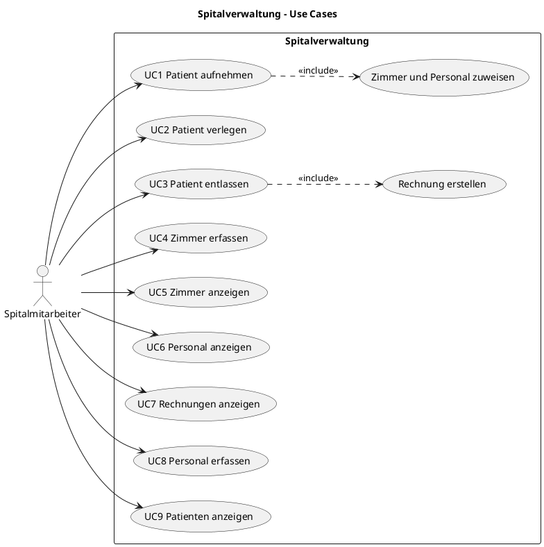
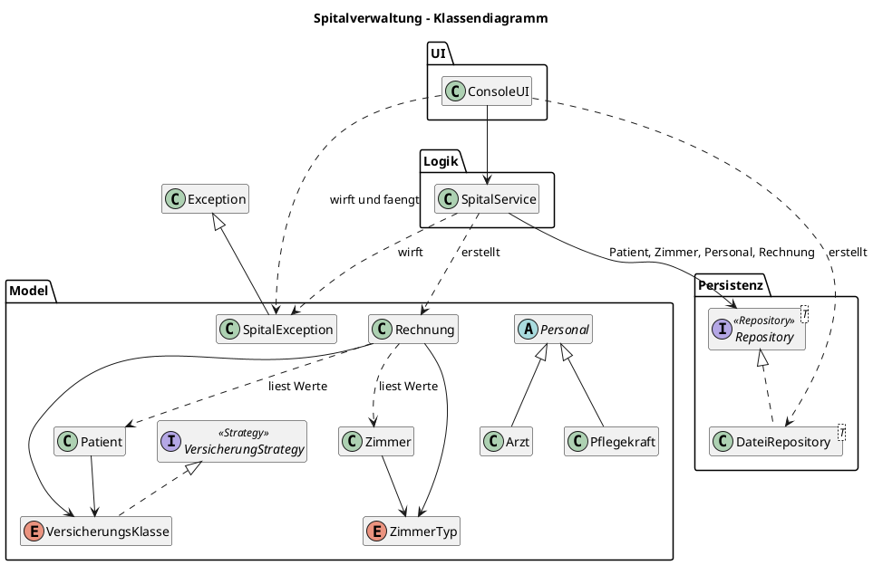
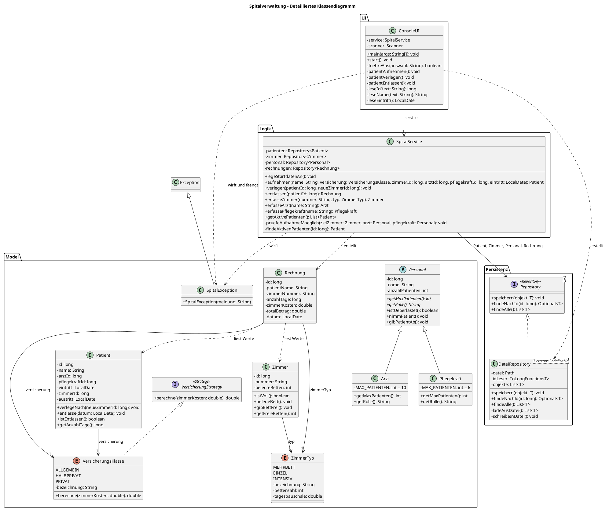
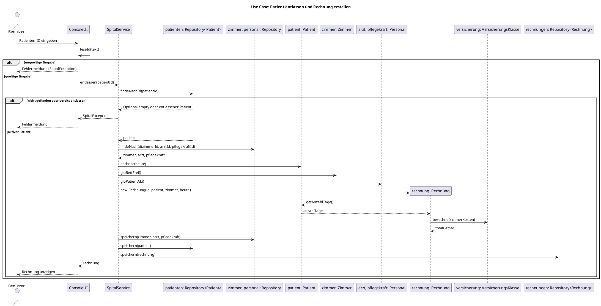

# Spitalverwaltung
## Ziel

Mit Hilfe von KI und den Unterrichtsinhalten erstellen Sie eine Applikation, welche die OO-Programmierthemen abdeckt, dh. Delegation, Polymorphismus. Sie wenden dabei auch Design Patterns an (mind. 2).

## Status der Kompetenzen

### M4

| Anforderung | Status | Stelle im Dokument |
|---|---|---|
| Grobes Klassendiagramm mit Hierarchie und Interfaces | umgesetzt | «Klassendiagramm (Skizze, nur Klassennamen)» |
| Detailliertes Klassendiagramm nach Abschluss | umgesetzt | «Detailliertes Klassendiagramm» |
| Sequenzdiagramm für einen Use Case | umgesetzt | «Sequenzdiagramm: UC3 Patient entlassen» |
| Beschreibung, Anforderungen und Use Cases | umgesetzt | «Beschreibung der Applikation», «Anforderungen», «Use Cases» |
| Prompts dokumentiert | umgesetzt | [KI-Doku.md](KI-Doku.md) |

D4, V4 und Q4 stehen in [cleancode.md](cleancode.md), der KI-Einsatz und die Prompts in [KI-Doku.md](KI-Doku.md).

## Beschreibung der Applikation

Die Applikation verwaltet ein kleines Spital. Patienten werden aufgenommen, einem Zimmer, einem Arzt und einer Pflegekraft zugewiesen, bei Bedarf verlegt und entlassen. Bei der Entlassung erstellt das System automatisch eine Rechnung.

Es gibt drei Zimmertypen (Mehrbett-, Einzel- und Intensivzimmer) mit unterschiedlicher Bettenzahl und Tagespauschale. Die Rechnung hängt zusätzlich von der Versicherungsklasse ab (allgemein, halbprivat, privat). Volle Zimmer, überlastetes Personal und falsche Eingaben werden mit Fehlermeldungen abgefangen.

### Muss-Kriterien

- Patienten aufnehmen, verlegen und entlassen
- Patienten einem Zimmer, einem Arzt und einer Pflegekraft zuweisen
- Drei Zimmertypen mit eigener Bettenzahl und Tagespauschale
- Automatische Rechnung bei der Entlassung, abhängig von Zimmer, Aufenthaltsdauer und Versicherungsklasse
- Daten werden dauerhaft gespeichert
- Fehlermeldungen bei vollen Zimmern, überlastetem Personal und falschen Eingaben

### Nice-to-have

- Personal in der Applikation erfassen (umgesetzt als UC8), bearbeiten ist nicht umgesetzt
- Patienten nach Namen suchen
- Rechnung als Datei exportieren
- Grafische Oberfläche oder Web-Oberfläche

## Anforderungen

| Nr. | Anforderung |
|---|---|
| A1 | Ein Zimmer kann nicht mehr Patienten aufnehmen, als es Betten hat. |
| A2 | Ärzte und Pflegekräfte haben eine maximale Anzahl Patienten. |
| A3 | Bei einer Verlegung wird das alte Bett frei und ein Bett im neuen Zimmer belegt. |
| A4 | Bei der Entlassung werden Bett und Personal freigegeben. |
| A5 | Der Rechnungsbetrag ergibt sich aus Anzahl Tage, Tagespauschale und Versicherungsklasse. |
| A6 | Benutzereingaben werden geprüft. Bei Fehlern erscheint eine Meldung und die Applikation läuft weiter. |
| A7 | Daten bleiben nach einem Neustart erhalten. |
| A8 | User-Interface, Logik und persistente Daten sind sauber getrennt. |

## Use Cases

| Nr. | Use Case | Beschreibung |
|---|---|---|
| UC1 | Patient aufnehmen | Patient erfassen und Zimmer, Arzt und Pflegekraft zuweisen |
| UC2 | Patient verlegen | Patient in ein anderes Zimmer verlegen |
| UC3 | Patient entlassen | Aufenthalt beenden und Rechnung automatisch erstellen |
| UC4 | Zimmer erfassen | Neues Zimmer mit Typ und Nummer anlegen |
| UC5 | Zimmer anzeigen | Zimmer mit freien und belegten Betten anzeigen |
| UC6 | Personal anzeigen | Ärzte und Pflegekräfte mit ihrer Auslastung anzeigen |
| UC7 | Rechnungen anzeigen | Erstellte Rechnungen anzeigen |
| UC8 | Personal erfassen | Neuen Arzt oder neue Pflegekraft anlegen |
| UC9 | Patienten anzeigen | Aktive Patienten anzeigen |

### Use-Case-Diagramm

### Use-Case-Beschreibung: UC1 Patient aufnehmen

| Punkt | Beschreibung |
|---|---|
| **Name** | UC1 Patient aufnehmen |
| **Akteur** | Spitalmitarbeiter |
| **Ziel** | Ein neuer Patient ist erfasst und hat ein Zimmer, einen Arzt und eine Pflegekraft. |
| **Vorbedingung** | Zimmer und Personal sind im System vorhanden. |
| **Eingaben** | Name, Versicherungsklasse, Eintrittsdatum (leer = heute), Zimmer-ID, Arzt-ID, Pflegekraft-ID |
| **Hauptablauf** | 1. Der Mitarbeiter wählt «Patient aufnehmen». 2. Der Mitarbeiter gibt die Daten ein. 3. `ConsoleUI` prüft die Eingaben. 4. `SpitalService` sucht Zimmer, Arzt und Pflegekraft. 5. `SpitalService` prüft, ob ein Bett frei ist und das Personal noch Kapazität hat. 6. Bett und Personal werden belegt, der Eintritt wird gesetzt. 7. Der Patient wird gespeichert. 8. `ConsoleUI` zeigt eine Bestätigung an. |
| **Fehlerfall: falsche Eingabe** | Zum Beispiel Text statt ID. Es erscheint eine Fehlermeldung, nichts wird gespeichert. |
| **Fehlerfall: nicht gefunden** | Zimmer oder Personal existiert nicht. Es erscheint eine Fehlermeldung, nichts wird gespeichert. |
| **Fehlerfall: Zimmer voll** | Im Zimmer ist kein Bett frei. Es erscheint eine Fehlermeldung, nichts wird gespeichert. |
| **Fehlerfall: Personal überlastet** | Arzt oder Pflegekraft hat die maximale Anzahl Patienten erreicht. Es erscheint eine Fehlermeldung, nichts wird gespeichert. |
| **Nachbedingung** | Der Patient ist gespeichert, ein Bett ist belegt, und die Auslastung des Personals ist erhöht. |

## Aufbau

Die Applikation hat **10 Klassen**, dazu 2 Interfaces und 2 Enums.

| Schicht | Typen | Aufgabe |
|---|---|---|
| UI | `ConsoleUI` | Applikation starten, Eingaben lesen und prüfen, Ausgaben anzeigen |
| Logik | `SpitalService` | Abläufe und Regeln umsetzen, Rechnung erstellen |
| Model | `Patient`, `Zimmer`, `Personal`, `Arzt`, `Pflegekraft`, `Rechnung`, `ZimmerTyp`, `VersicherungsKlasse`, `VersicherungStrategy` | Daten und Regeln der einzelnen Objekte |
| Persistenz | `Repository<T>`, `DateiRepository<T>` | Daten speichern und laden, generisch für jeden Datentyp |
| Fehler | `SpitalException` | Eigene Exception für alle Fehlerfälle |

Die 10 Klassen sind: `ConsoleUI`, `SpitalService`, `DateiRepository<T>`, `Patient`, `Zimmer`, `Personal`, `Arzt`, `Pflegekraft`, `Rechnung`, `SpitalException`.

**Umfang:** 958 Zeilen in `src/M4`, davon 798 ohne Leerzeilen.

### Klassendiagramm (Skizze, nur Klassennamen)

### Detailliertes Klassendiagramm (Stand nach Abschluss des Projekts)

Das Diagramm oben ist die grobe Skizze der Architektur. Dieses Diagramm zeigt den umgesetzten Code mit den Abstraktionen: `Personal` ist eine abstrakte Klasse, `VersicherungStrategy` und `Repository<T>` sind Interfaces. Einfache Getter sind weggelassen, damit das Diagramm lesbar bleibt.

### Details der Klassen

Die wichtigsten Attribute und Methoden noch einmal als Übersicht:

| Typ | Wichtige Attribute | Wichtige Methoden |
|---|---|---|
| `ConsoleUI` | `service` | `main()`, `start()`, `fuehreAus()`, `patientAufnehmen()`, `patientVerlegen()`, `patientEntlassen()`, `leseId()`, `leseName()` |
| `SpitalService` | `patienten`, `zimmer`, `personal`, `rechnungen` | `legeStartdatenAn()`, `aufnehmen()`, `verlegen()`, `entlassen()`, `erfasseZimmer()`, `erfasseArzt()`, `erfassePflegekraft()` |
| `Patient` | `id`, `name`, `versicherung`, `zimmerId`, `arztId`, `pflegekraftId`, `eintritt`, `austritt` | `verlegeNach()`, `entlasse()`, `istEntlassen()`, `getAnzahlTage()` |
| `Zimmer` | `id`, `nummer`, `typ`, `belegteBetten` | `istVoll()`, `belegeBett()`, `gibBettFrei()`, `getFreieBetten()` |
| `Personal` (abstrakt) | `id`, `name`, `anzahlPatienten` | `istUeberlastet()`, `nimmPatient()`, `gibPatientAb()`, `getMaxPatienten()`, `getRolle()` |
| `Arzt`, `Pflegekraft` | `MAX_PATIENTEN` | `getMaxPatienten()`, `getRolle()` |
| `Rechnung` | `id`, `patientName`, `zimmerNummer`, `anzahlTage`, `zimmerKosten`, `totalBetrag`, `datum` | Getter |
| `ZimmerTyp` (Enum) | `bezeichnung`, `bettenzahl`, `tagespauschale` | Getter |
| `VersicherungsKlasse` (Enum) | `bezeichnung` | `berechne()` |
| `VersicherungStrategy` (Interface) | – | `berechne()` |
| `Repository<T>` (Interface) | – | `speichern()`, `findeNachId()`, `findeAlle()` |
| `DateiRepository<T>` | `datei`, `idLeser`, `objekte` | `speichern()`, `findeNachId()`, `findeAlle()` |
| `SpitalException` | – | Konstruktor mit Meldung |

### Sequenzdiagramm: UC3 Patient entlassen

## Design Patterns

| Pattern | Wo | Warum es hier Sinn macht |
|---|---|---|
| **Strategy** | Interface `VersicherungStrategy`, umgesetzt von den Werten des Enums `VersicherungsKlasse` | Jede Versicherungsklasse rechnet anders. `Rechnung` ruft nur `berechne()` auf und braucht keine langen `if`-Abfragen. Das Enum spart drei eigene Klassen. |
| **Repository** | Interface `Repository<T>`, umgesetzt von `DateiRepository<T>` | Die Logik kennt nur das Interface und nicht die Art der Speicherung. So bleibt die Trennung von Logik und persistenten Daten sauber. |

## Umsetzung der Objektorientierung

- **Delegation:** `ConsoleUI` gibt die Abläufe an `SpitalService` weiter. `SpitalService` delegiert das Speichern an `Repository<T>`, `Rechnung` delegiert die Berechnung an die Versicherungsklasse. Das sind HAT-Beziehungen: `SpitalService` hat die Repositories als Attribute und erhält sie als Parameter im Konstruktor (Aggregation).
- **Generics:** Die eigene Klasse `DateiRepository<T>` funktioniert für `Patient`, `Zimmer`, `Personal` und `Rechnung`, ohne den Code mehrfach zu schreiben.
- **Vererbung:** `Personal` ist eine abstrakte Klasse, weil `Arzt` und `Pflegekraft` gemeinsame Daten und gemeinsames Verhalten haben. Die Zimmertypen unterscheiden sich nur in Bettenzahl und Tagespauschale, darum genügt dort das Enum `ZimmerTyp` ohne Vererbung.
- **Polymorphismus:** `getMaxPatienten()` und `berechne()` werden je nach Objekt unterschiedlich ausgeführt.
- **Interfaces:** `VersicherungStrategy` und `Repository<T>`.

## Validierung und Exceptions

Alle Fehler verwenden die eigene Klasse `SpitalException` mit einer passenden Meldung:

| Fall | Beispiel |
|---|---|
| Falsche Eingabe | Text statt ID |
| Nicht gefunden | Patient, Zimmer oder Personal existiert nicht |
| Zimmer voll | Im Zimmer ist kein Bett mehr frei |
| Personal überlastet | Arzt oder Pflegekraft hat die maximale Anzahl Patienten erreicht |

`ConsoleUI` prüft die Eingaben, fängt die Exceptions ab und zeigt die Meldung an.

## Festgelegte Werte

Die Werte sind frei gewählte Beispielwerte für dieses Projekt und keine echten Spitaltarife.

| Zimmertyp | Betten | Tagespauschale |
|---|---|---|
| Mehrbettzimmer | 4 | CHF 300 |
| Einzelzimmer | 1 | CHF 500 |
| Intensivzimmer | 2 | CHF 1200 |

| Versicherungsklasse | Faktor | Beispiel: 5 Tage im Mehrbettzimmer (CHF 1500) |
|---|---|---|
| Allgemein | 1.0 | CHF 1500 |
| Halbprivat | 1.3 | CHF 1950 |
| Privat | 1.6 | CHF 2400 |

Berechnung: `Tage × Tagespauschale × Faktor`

**Bekannte Einschränkung:** Nach einer Verlegung wird der ganze Aufenthalt zur Tagespauschale des letzten Zimmers verrechnet, weil der Patient nur sein aktuelles Zimmer speichert.

| Personal | Maximale Anzahl Patienten |
|---|---|
| Arzt | 10 |
| Pflegekraft | 6 |

**Speicherung:** `DateiRepository<T>` speichert die Objekte mit Java-Serialisierung in Dateien. Die gespeicherten Klassen müssen deshalb `Serializable` implementieren.

## Starten

In IntelliJ `src/M4/ConsoleUI.java` öffnen und auf ▶ klicken. Beim ersten Start werden Beispielzimmer und Beispielpersonal angelegt. Die Daten liegen im Ordner `daten`.

## Umgesetzte Use Cases

Alle Use Cases wurden über die Konsole getestet. Der Start in IntelliJ wurde dabei nicht geprüft.

| Nr. | Use Case | Menüpunkt | Methode in `SpitalService` | Getestetes Ergebnis |
|---|---|---|---|---|
| UC1 | Patient aufnehmen | 1 | `aufnehmen()` | Aufnahme klappt, volles Zimmer und überlastete Pflegekraft ergeben eine Fehlermeldung |
| UC2 | Patient verlegen | 2 | `verlegen()` | Altes Bett wird frei, neues Bett wird belegt |
| UC3 | Patient entlassen | 3 | `entlassen()` | 5 Tage, Mehrbettzimmer, Privat: CHF 2400. Zweite Entlassung ergibt eine Fehlermeldung |
| UC4 | Zimmer erfassen | 4 | `erfasseZimmer()` | Neues Zimmer wird angelegt, doppelte Nummer ergibt eine Fehlermeldung |
| UC5 | Zimmer anzeigen | 5 | `getZimmer()` | Freie Betten werden angezeigt und stimmen nach einem Neustart |
| UC6 | Personal anzeigen | 6 | `getPersonal()` | Auslastung wird angezeigt und stimmt nach einem Neustart |
| UC7 | Rechnungen anzeigen | 7 | `getRechnungen()` | Rechnung bleibt nach einem Neustart erhalten |
| UC8 | Personal erfassen | 8 | `erfasseArzt()`, `erfassePflegekraft()` | Beide Rollen werden angelegt, falsche Rolle ergibt eine Fehlermeldung |
| UC9 | Patienten anzeigen | 9 | `getAktivePatienten()` | Entlassene Patienten werden nicht mehr angezeigt |

## Fazit über den Lernprozess

*Entwurf der KI aus dem tatsächlichen Projektverlauf. Vor der Abgabe prüfen und in eigenen Worten ergänzen.*

Am Anfang war mir nicht klar, was eine Exception-Klasse genau macht. Durch Nachfragen habe ich gelernt, dass nicht die Klasse, sondern ein Objekt geworfen wird und dass `super(message)` die Meldung an die Elternklasse weitergibt. Bei der Delegation habe ich gelernt, dass ein Objekt eine Aufgabe an ein anderes Objekt weitergibt, das es als Attribut hat.

Bei der Planung habe ich das Klassendiagramm von vielen Klassen auf 10 Klassen reduziert. Dadurch ist der Aufbau einfacher, aber `ConsoleUI` und `SpitalService` haben mehr Aufgaben bekommen.

Die Applikation habe ich nicht selbst programmiert, sondern vollständig von der KI generieren lassen, weil ich schnell ein laufendes Projekt brauchte. Das Projekt läuft, aber dadurch habe ich beim Programmieren selbst weniger gelernt. Beim nächsten Projekt würde ich früher anfangen und mehr Code selbst schreiben.

## Auftrag

### Auftrag

- Sie erstellen eine kurze Beschreibung der Applikation. Was ist das Ziel? (Muss-Kriterien) Was könnte noch umgesetzt werden (nice-to-have)?
- Sie erstellen eine Skizze der geplanten Architektur (UML Klassendiagramm).
- Falls Sie das Klassendiagramm von der KI generieren lassen, dokumentieren Sie die Schritte (d.h. die Prompts) und listen Sie auch diese in einem Markdown.
- Sie beschreiben die Anforderungen an das Projekt und listen die Use Cases auf (d.h. was kann der Benutzer mit der Applikation machen).
- Erstellen Sie für einen typischen Use Case ein ungefähres Sequenzdiagramm. Die KI generiert Ihnen dieses auch.
- Alles dokumentieren: Diese Diagramme und die Anforderungen werden in einem Markdown Dokument in ihr Repository abgelegt.

### Vorgaben an das Projekt

- Die Applikation ist oo-basiert (von Vorteil basierend auf JVM). UI ist nicht zwingend.
- Richtwert: Sie verwenden mind. 8 selbstgeschriebene Klassen. Code-Umfang ist bei mind. 800 Zeilen.
- Die Hilfe von KI ist erlaubt, Sie müssen das aber im Code ersichtlich deklarieren. Wenn die komplette Applikation mit KI generiert wird, wird die Arbeit nicht akzeptiert.
- Die Applikation ist sauber getrennt mit User-Interface, Logik, persistente Daten (Daten werden in einer Form gespeichert, z.Bsp. in einer DB).
- Validierung von User-Input ist vorhanden (Exception Handling bei Fehler).
- Design Patterns (mind. zwei) sind im Code ersichtlich und von Ihnen beschrieben. (mit Begründung, wieso dieses Pattern hier Sinn macht).
- Interfaces werden verwendet.
- Eine Vererbungshierarchie wird implementiert wenn es Sinn macht. Sie erklären wieso, falls Sie keine Vererbung einsetzen.
- Sie wenden Clean-Code Regeln an und dokumentieren das im Code (aufzeigen wo).
- SpringBoot kann verwendet werden (falls Sie dieses Framework schon kennen, dann verwenden Sie dieses).

### Abgabe

- Abgabe erfolgt durch ein Repository. Alle Commits müssen per Timestamp nachvollziehbar sein (nur ein einziger Commit ist nicht erlaubt und führt zu Punktabzug).
- Abgabe beinhaltet aktuelles Klassendiagramm, sowie ein Sequenzdiagramm von einem typischen Use Case. Sie können diese Diagramme mit der KI generieren - dokumentieren Sie den Prompt.
- In einem Markdown sammeln Sie die Dokumentation zusammen (UML Diagramme, Beschreibung der Applikation, umgesetzt Use Cases sowie ein Fazit über den gemachten Lernprozess).
- Sie demonstrieren eine lauffähige Applikation bei der Lehrperson, gem. Ihren aufgelisteten Use Cases (die Use Cases dienen als Basis für eine Demonstration der Applikation).
