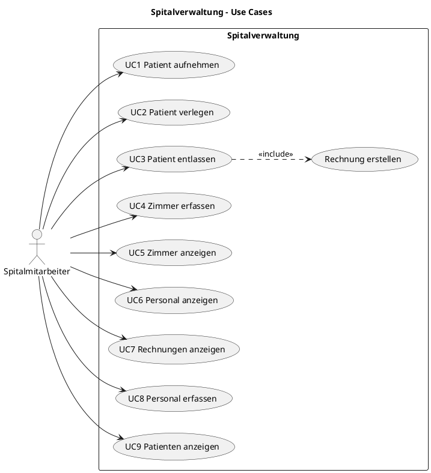
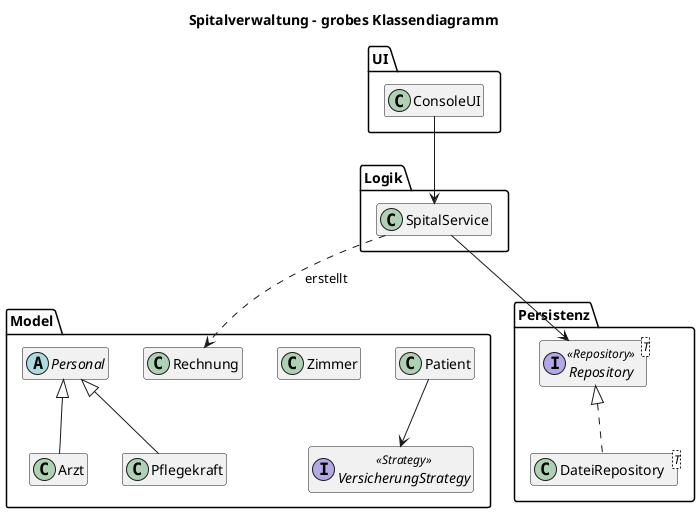
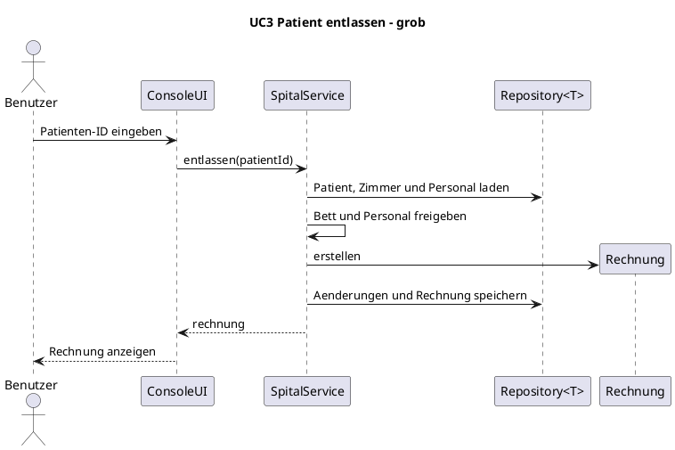
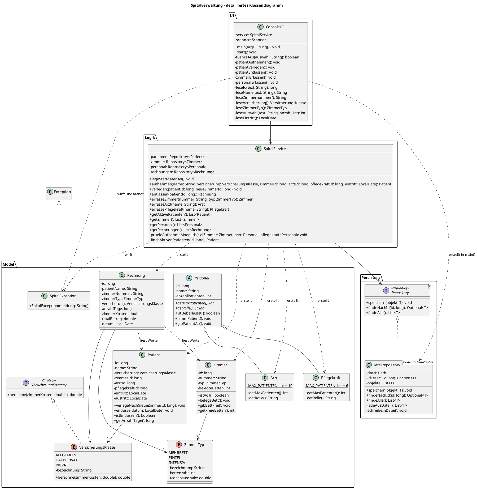
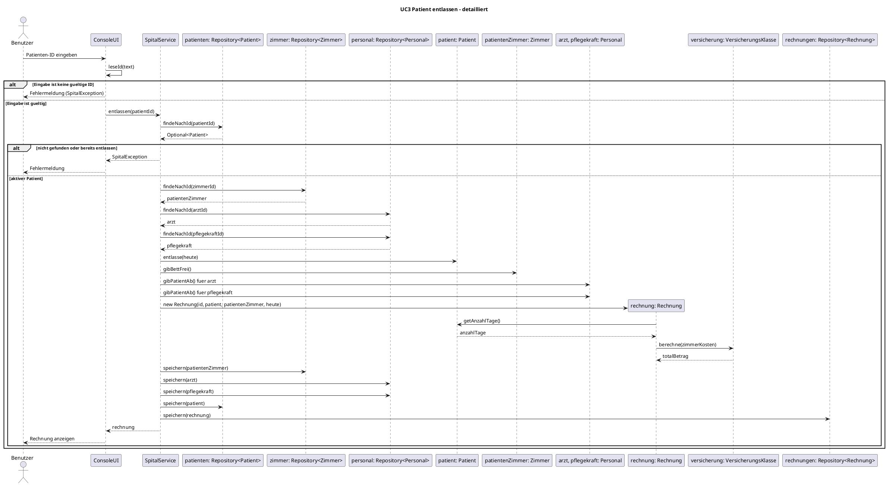

# Kompetenznachweis M4: Spitalverwaltung

Weitere Dokumente: [KI-Doku](KI-Doku.md) · [Clean Code](cleancode.md) · [alle Diagramme als PlantUML](Diagramme.puml)

Code: [`src/M4`](../src/M4)

## 1. Beschreibung der Applikation

Die Konsolenapplikation verwaltet ein kleines Spital. Patienten werden aufgenommen, einem Zimmer, einem Arzt und einer Pflegekraft zugewiesen, bei Bedarf verlegt und entlassen. Bei der Entlassung entsteht automatisch eine Rechnung.

### Ziel (Muss-Kriterien)

- Patienten aufnehmen, verlegen und entlassen
- Patienten einem Zimmer, einem Arzt und einer Pflegekraft zuweisen
- Drei Zimmertypen mit eigener Bettenzahl und Tagespauschale
- Automatische Rechnung, abhängig von Zimmer, Aufenthaltsdauer und Versicherungsklasse
- Daten bleiben nach einem Neustart erhalten
- Fehlermeldungen bei falschen Eingaben, vollen Zimmern und überlastetem Personal

### Nice-to-have

| Idee | Stand |
|---|---|
| Personal in der Applikation erfassen | umgesetzt (UC8) |
| Personal bearbeiten | nicht umgesetzt |
| Patienten nach Namen suchen | nicht umgesetzt |
| Rechnung als Datei exportieren | nicht umgesetzt |
| Grafische Oberfläche oder Web-Oberfläche | nicht umgesetzt |

## 2. Anforderungen

| Nr. | Anforderung |
|---|---|
| A1 | Ein Zimmer nimmt nicht mehr Patienten auf, als es Betten hat. |
| A2 | Ärzte betreuen maximal 10 Patienten, Pflegekräfte maximal 6. |
| A3 | Bei einer Verlegung wird das alte Bett frei und ein Bett im neuen Zimmer belegt. |
| A4 | Bei der Entlassung werden Bett und Personal freigegeben. |
| A5 | Rechnungsbetrag = Anzahl Tage × Tagespauschale × Faktor der Versicherungsklasse. |
| A6 | Eingaben werden geprüft. Bei einem Fehler erscheint eine Meldung und die Applikation läuft weiter. |
| A7 | Daten bleiben nach einem Neustart erhalten. |
| A8 | User-Interface, Logik und persistente Daten sind getrennt. |

### Festgelegte Werte

Die Werte sind frei gewählte Beispielwerte und keine echten Spitaltarife.

| Zimmertyp | Betten | Tagespauschale |
|---|---|---|
| Mehrbettzimmer | 4 | CHF 300 |
| Einzelzimmer | 1 | CHF 500 |
| Intensivzimmer | 2 | CHF 1200 |

| Versicherungsklasse | Faktor | Beispiel: 5 Tage im Mehrbettzimmer (CHF 1500) |
|---|---|---|
| Allgemein | 1.0 | CHF 1500 |
| Halbprivat | 1.3 | CHF 1950 |
| Privat | 1.6 | CHF 2400 |

Ein Aufenthalt wird mit mindestens einem Tag verrechnet.

## 3. Use Cases

| Nr. | Use Case | Was der Benutzer macht |
|---|---|---|
| UC1 | Patient aufnehmen | Patient erfassen und Zimmer, Arzt und Pflegekraft zuweisen |
| UC2 | Patient verlegen | Patient in ein anderes Zimmer verlegen |
| UC3 | Patient entlassen | Aufenthalt beenden, Rechnung wird automatisch erstellt |
| UC4 | Zimmer erfassen | Neues Zimmer mit Nummer und Typ anlegen |
| UC5 | Zimmer anzeigen | Zimmer mit freien Betten ansehen |
| UC6 | Personal anzeigen | Ärzte und Pflegekräfte mit Auslastung ansehen |
| UC7 | Rechnungen anzeigen | Erstellte Rechnungen ansehen |
| UC8 | Personal erfassen | Neuen Arzt oder neue Pflegekraft anlegen |
| UC9 | Patienten anzeigen | Aktive Patienten ansehen |



## 4. Geplante Architektur (Skizze)

Die Skizze zeigt nur Klassen und Beziehungen: die Hierarchie `Personal` → `Arzt`, `Pflegekraft` und die Interfaces `VersicherungStrategy` und `Repository<T>`.

*Hinweis: Diese Skizze wurde für diese Fassung der Dokumentation neu gezeichnet und ist darum nicht älter als der Code. Laut Git-Verlauf entstand der Code vor der Dokumentation.*



Grobes Sequenzdiagramm für den typischen Use Case UC3:



## 5. Umgesetzte Architektur

Die Applikation hat **10 Klassen, 2 Interfaces und 2 Enums** mit insgesamt rund 960 Zeilen (inklusive Leerzeilen und Getter).

| Schicht | Typen | Aufgabe |
|---|---|---|
| UI | `ConsoleUI` | Starten, Eingaben lesen und prüfen, Ausgaben anzeigen |
| Logik | `SpitalService` | Abläufe und Regeln, Rechnung auslösen |
| Model | `Patient`, `Zimmer`, `Personal`, `Arzt`, `Pflegekraft`, `Rechnung`, `ZimmerTyp`, `VersicherungsKlasse`, `VersicherungStrategy` | Daten und Verhalten der einzelnen Objekte |
| Persistenz | `Repository<T>`, `DateiRepository<T>` | Speichern und Laden mit Java-Serialisierung im Ordner `daten` |
| Fehler | `SpitalException` | Eigene Exception für alle erwarteten Fehler |

### Detailliertes Klassendiagramm

Getter und die Anzeigemethoden von `ConsoleUI` sind der Übersicht halber weggelassen.



### Detailliertes Sequenzdiagramm: UC3 Patient entlassen



## 6. Design Patterns

| Pattern | Wo im Code | Warum es hier Sinn macht |
|---|---|---|
| **Strategy** | Interface `VersicherungStrategy`, umgesetzt von den Werten des Enums `VersicherungsKlasse`, aufgerufen in `Rechnung` | Jede Versicherungsklasse berechnet den Betrag auf ihre Art. `Rechnung` ruft nur `berechne()` auf und braucht keine `if`-Kette. Eine neue Klasse kommt als neuer Enum-Wert dazu, ohne dass `Rechnung` sich ändert. |
| **Repository** | Interface `Repository<T>`, umgesetzt von `DateiRepository<T>`, verwendet in `SpitalService` | `SpitalService` kennt nur das Interface. Die Speicherung in Dateien könnte durch eine Datenbank ersetzt werden, ohne die Logik anzupassen. |

## 7. Objektorientierung im Projekt

### Delegation

`ConsoleUI.patientEntlassen()` gibt die Arbeit an `SpitalService.entlassen()` weiter. `SpitalService` delegiert das Speichern an `Repository<T>`, und `Rechnung` delegiert die Berechnung an `versicherung.berechne()`.

Delegation beruht auf HAT-Beziehungen: Die Klasse hat eine Referenz auf das andere Objekt. So werden die Objekte registriert:

| Variante | Stelle im Code | HAT-Beziehung |
|---|---|---|
| Bei der Deklaration instanziieren | `ConsoleUI`: `private final Scanner scanner = new Scanner(System.in)` | Komposition |
| Über den Konstruktor übergeben | `SpitalService` erhält die vier Repositories, `ConsoleUI` erhält den `SpitalService` | Aggregation |
| Im Konstruktor instanziieren | `DateiRepository`: `objekte = ladeAusDatei()` | Komposition |

Setter und Lazy Initialization sind nicht nötig, weil alle Abhängigkeiten beim Start bekannt sind.

### Vererbung und Polymorphismus

- **Vererbung:** `Arzt` und `Pflegekraft` erben von der abstrakten Klasse `Personal`, weil beide die gleichen Daten und das gleiche Verhalten haben und sich nur in Rolle und Maximalzahl unterscheiden.
- **Keine Vererbung bei den Zimmern:** Die Zimmertypen unterscheiden sich nur in ihren Werten und nicht im Verhalten. Darum genügt das Enum `ZimmerTyp`.
- **Überschreiben und Dynamic Binding:** `Personal.istUeberlastet()` ruft `getMaxPatienten()` auf. Erst zur Laufzeit entscheidet der echte Objekttyp, ob 10 oder 6 gilt. Dasselbe gilt für `berechne()` bei den Enum-Werten.
- **Überladen (statischer Polymorphismus):** wird im eigenen Code nicht verwendet, weil keine Methode mehrere Parameterlisten braucht.
- **Upcasting:** `Personal person = rolle.equals("1") ? service.erfasseArzt(name) : service.erfassePflegekraft(name);` in `ConsoleUI.personalErfassen()`.
- **Typprüfung statt Downcast:** `SpitalService.findeArzt()` prüft mit `Arzt.class::isInstance`, ob die ID wirklich zu einem Arzt gehört. So kann keine `ClassCastException` entstehen.

### Interfaces und Generics

Die Interfaces sind `VersicherungStrategy` und `Repository<T>`. Die eigene generische Klasse `DateiRepository<T>` wird für `Patient`, `Zimmer`, `Personal` und `Rechnung` verwendet, ohne dass der Code mehrfach geschrieben werden muss.

## 8. Validierung und Exception Handling

Alle erwarteten Fehler verwenden `SpitalException`. `ConsoleUI.start()` fängt sie ab, zeigt die Meldung an und führt das Menü weiter.

| Fall | Geprüft in | Meldung aus dem Test |
|---|---|---|
| Falsche Menüauswahl | `ConsoleUI.fuehreAus()` | Bitte eine Zahl aus dem Menü wählen. |
| Ungültiger Name | `ConsoleUI.leseName()` | Der Name muss 2-50 Zeichen lang sein und darf keine Zahlen enthalten. |
| Text statt ID | `ConsoleUI.leseId()` | Die ID muss eine ganze Zahl sein: 'abc' |
| Falsches Datum | `ConsoleUI.leseEintritt()` | Das Datum muss das Format JJJJ-MM-TT haben: 'morgen' |
| Zimmer existiert nicht | `SpitalService.findeZimmer()` | Zimmer mit ID 99 wurde nicht gefunden. |
| Pflegekraft-ID statt Arzt-ID | `SpitalService.findeArzt()` | Arzt mit ID 3 wurde nicht gefunden. |
| Zimmer voll | `SpitalService.pruefeAufnahmeMoeglich()` | Zimmer 102 ist voll. |
| Personal überlastet | `SpitalService.pruefeNichtUeberlastet()` | Pflegekraft Anna Frei ist überlastet (maximal 6 Patienten). |
| Doppelte Zimmernummer | `SpitalService.erfasseZimmer()` | Die Zimmernummer 103 ist bereits vergeben. |
| Patient bereits entlassen | `SpitalService.findeAktivenPatienten()` | Patient Anna Muster ist bereits entlassen. |

## 9. Starten und Demonstration

Getestet mit Java 26 in Git Bash, im Hauptordner des Repositorys:

```bash
javac -encoding UTF-8 -d out src/M4/*.java
```

```bash
java -cp out M4.ConsoleUI
```

In IntelliJ: `src/M4/ConsoleUI.java` öffnen und ▶ klicken (dieser Weg wurde nicht getestet). Beim ersten Start werden Beispielzimmer und Beispielpersonal angelegt. Für eine saubere Demo vorher den Ordner `daten` löschen.

### Umgesetzte Use Cases und Testergebnis

Alle Use Cases wurden am 02.11.2026 mit vorbereiteten Eingaben über die Konsole getestet, inklusive Neustart.

| Nr. | Menü | Methode in `SpitalService` | Ergebnis im Test |
|---|---|---|---|
| UC1 | 1 | `aufnehmen()` | Patient wird aufgenommen, Betten und Auslastung ändern sich |
| UC2 | 2 | `verlegen()` | Altes Bett wird frei, neues Bett wird belegt |
| UC3 | 3 | `entlassen()` | 5 Tage, Mehrbettzimmer, Privat: CHF 2400. Zweite Entlassung ergibt eine Fehlermeldung |
| UC4 | 4 | `erfasseZimmer()` | Zimmer 103 wird angelegt, doppelte Nummer ergibt eine Fehlermeldung |
| UC5 | 5 | `getZimmer()` | Freie Betten stimmen, auch nach dem Neustart |
| UC6 | 6 | `getPersonal()` | Auslastung stimmt, auch nach dem Neustart |
| UC7 | 7 | `getRechnungen()` | Rechnung ist nach dem Neustart noch vorhanden |
| UC8 | 8 | `erfasseArzt()`, `erfassePflegekraft()` | Beide Rollen werden angelegt, falsche Rolle ergibt eine Fehlermeldung |
| UC9 | 9 | `getAktivePatienten()` | Entlassene Patienten erscheinen nicht mehr |

### Vorschlag für den Ablauf der Demo

1. Zimmer (5) und Personal (6) anzeigen.
2. Patient mit Versicherung Privat und einem Eintritt vor 5 Tagen in Zimmer 101 aufnehmen (1).
3. Patient ins Zimmer 201 und wieder zurück verlegen (2), danach die freien Betten zeigen (5).
4. Patient entlassen (3): Die Rechnung zeigt CHF 2400.
5. Fehler zeigen: Text statt ID, zweiter Patient im Einzelzimmer.
6. Applikation beenden, neu starten und die Rechnung anzeigen (7).

## 10. Stand der Vorgaben

| Vorgabe | Stand | Nachweis |
|---|---|---|
| OO-basiert, JVM | erfüllt | Java, `src/M4` |
| Mindestens 8 Klassen, 800 Zeilen | erfüllt | 10 Klassen, rund 960 Zeilen |
| KI-Hilfe im Code deklariert | erfüllt | Kommentar `// KI-Hilfe` in allen 14 Dateien |
| Nicht komplett mit KI generiert | **nicht erfüllt** | Die gesamte Applikation ist KI-generiert, siehe [KI-Doku](KI-Doku.md). Muss mit der Lehrperson geklärt werden. |
| Trennung UI, Logik, Daten | erfüllt | Abschnitt 5 |
| Validierung und Exceptions | erfüllt | Abschnitt 8 |
| Mindestens 2 Design Patterns | erfüllt | Abschnitt 6 |
| Interfaces | erfüllt | `VersicherungStrategy`, `Repository<T>` |
| Vererbung | erfüllt | `Personal`, `Arzt`, `Pflegekraft` |
| Clean Code im Code ausgewiesen | erfüllt | Kommentare `// Clean Code (...)`, siehe [cleancode.md](cleancode.md) |

## 11. Fazit über den Lernprozess

*Entwurf der KI aus dem tatsächlichen Projektverlauf. Vor der Abgabe prüfen und in eigenen Worten schreiben.*

Am Anfang war mir nicht klar, was eine Exception-Klasse genau macht. Durch Nachfragen habe ich gelernt, dass ein Objekt geworfen wird und dass `super(message)` die Meldung an die Elternklasse weitergibt. Bei der Delegation habe ich gelernt, dass ein Objekt eine Aufgabe an ein anderes Objekt weitergibt, das es als Attribut hat.

Bei der Planung habe ich die Applikation auf 10 Klassen reduziert. Dadurch ist der Aufbau einfacher, aber `ConsoleUI` und `SpitalService` haben mehr Aufgaben bekommen.

Die Applikation habe ich nicht selbst programmiert, sondern von der KI generieren lassen, weil ich schnell ein laufendes Projekt brauchte. Das Projekt läuft, aber ich habe beim Programmieren selbst weniger gelernt. Beim nächsten Projekt würde ich früher anfangen und mehr Code selbst schreiben.
