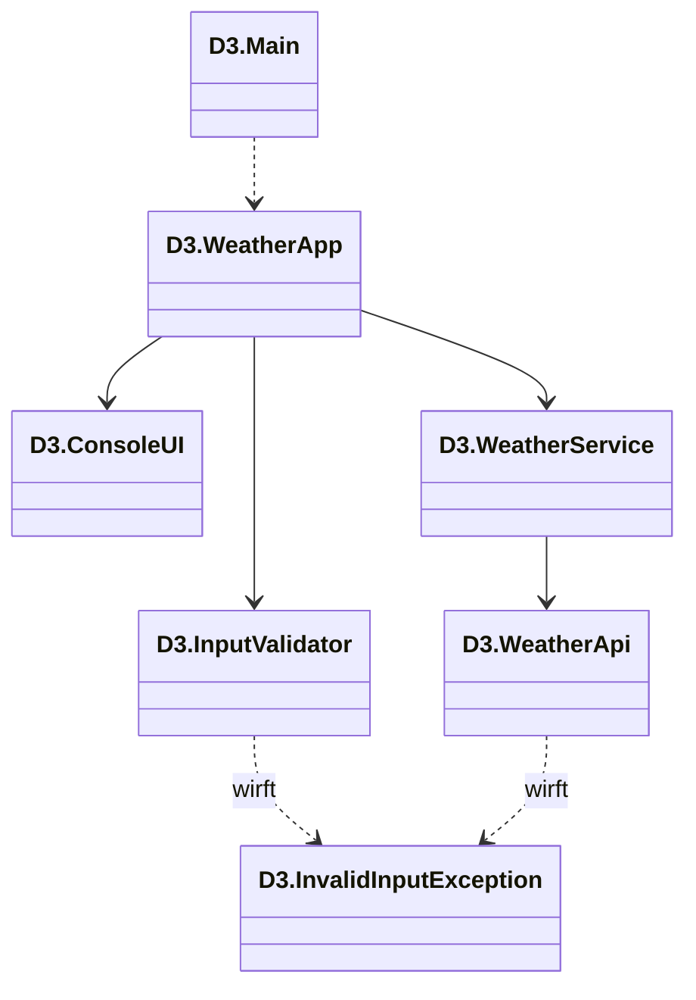

# M320_OOP – Wetter-Berater

Kompetenznachweis D3 (Delegation, eigene Exception, Trennung von UI / Logik / API)

## Beschreibung

Der **Wetter-Berater** ist eine kleine Java-Konsolenapplikation. Der Benutzer gibt eine Stadt
ein. Die App holt über die kostenlose [Open-Meteo API](https://open-meteo.com) (kein API-Key)
die aktuelle Temperatur und gibt eine Kleidungsempfehlung aus. Mit `exit` wird die App beendet.

Ungültige Eingaben (leer, Zahlen oder Sonderzeichen, unbekannte Stadt) führen zu einer eigenen
`D3.InvalidInputException`. Die App zeigt dann eine Fehlermeldung und fragt erneut.

```
Stadt: Zürich
In Zürich ist es 14.2 °C.
Empfehlung: Pullover

Stadt: Z123
Fehler: Die Stadt darf nur Buchstaben enthalten.
```

## Klassen

| Klasse                  | Aufgabe                                          |
|-------------------------|--------------------------------------------------|
| `D3.Main`                  | Startet nur die App                              |
| `D3.WeatherApp`            | Steuert den Ablauf und delegiert an die anderen  |
| `D3.ConsoleUI`             | User-Input und Ausgabe                           |
| `D3.InputValidator`        | Prüft die Eingabe, wirft `D3.InvalidInputException` |
| `D3.WeatherService`        | Logik: Temperatur holen, Empfehlung berechnen    |
| `D3.WeatherApi`            | Aufruf der fremden API (HTTP)                    |
| `D3.InvalidInputException` | Eigene Exception für falsche Eingaben            |



## Fragen zur Besprechung

**Delegation:** `D3.WeatherApp` macht die Arbeit nicht selbst. Die Ein- und Ausgabe gibt sie an
`D3.ConsoleUI` ab, die Prüfung an `D3.InputValidator` und die Logik an `D3.WeatherService`.
`D3.WeatherService` gibt den API-Aufruf an `D3.WeatherApi` weiter.

**Kommunikation:** Die Objekte rufen gegenseitig Methoden auf und geben Werte als Parameter mit.
Das Resultat kommt als Rückgabewert zurück:
`askCity()` → `"Zürich"` → `validateCity("Zürich")` → `getTemperature("Zürich")` →
`findCoordinates("Zürich")` → `getTemperature(lat, lon)` → `14.2` → `getRecommendation(14.2)` →
`showResult(...)`. Fehler werden als Exception zurückgegeben und in `D3.WeatherApp` abgefangen.

**Trennung:** Nur `D3.ConsoleUI` liest und schreibt auf die Konsole. Nur `D3.WeatherService` enthält
Logik. Nur `D3.WeatherApi` kennt URLs und HTTP.

## Starten

In IntelliJ `src/D3.Main.java` öffnen und auf ▶ klicken. Es braucht eine Internetverbindung.
